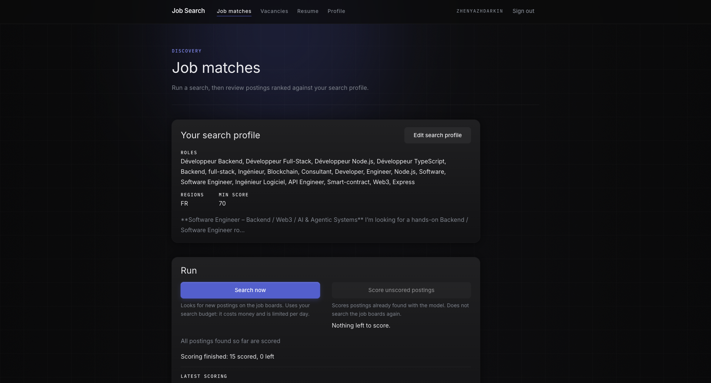

# Job Search

A personal tool that ties together the three things I needed for my own job search: an AI chat that edits a structured resume against my real career history and each vacancy's text, a LaTeX renderer that turns that resume straight into a polished PDF, and a tracker for every vacancy I'm targeting (not applied → applied → interview → offer/rejected/withdrawn). One place instead of a resume doc, a LaTeX template, and a spreadsheet.

## Demo




## Repository layout

| Path | Role |
|------|------|
| [`core-api/`](core-api/) | Spring Boot HTTP API (Postgres, OpenRouter, LaTeX → PDF) |
| [`frontend/`](frontend/) | React + Vite UI |
| [`tools/latex-worker/`](tools/latex-worker/) | Sandboxed LaTeX → PDF service used by core-api's compile queue, on `:8090` |
| [`tools/ats-worker/`](tools/ats-worker/) | Checks that an ATS can read the built PDF and scores the resume with an LLM (prompt from ATS Screener), on `:8091` |
| [`docker-compose.yml`](docker-compose.yml) | Local Postgres + latex-worker |
| [`.env.example`](.env.example) | Environment template |

## Documentation

- **Backend:** [core-api/README.md](core-api/README.md) — stack, auth, config, schema, full HTTP API
- **Frontend:** React + Vite SPA in [`frontend/`](frontend/) — resume sheet editor, AI chat panel, vacancy list/detail, ATS match panel

## Quick start (one command)

Prerequisites: Docker, Java 25, Node 18+. PDFs are built by the `latex-worker` container, so no local `tectonic` is needed.

```bash
cp .env.example .env
# set OPENROUTER_API_KEY in .env
# set APP_ADMIN_EMAIL and APP_BOOTSTRAP_PASSWORD (>= 12 chars, required on a fresh DB — otherwise the admin has no password) — registration is invite-only,
# this is the account the backend auto-creates as ADMIN on first boot
# set LATEX_WORKER_TOKEN to any random string — shared by core-api and the latex-worker container
# set ATS_WORKER_TOKEN to any random string — shared by core-api and the ats-worker container (OPENROUTER_API_KEY is used for the vacancy match)

git submodule update --init --recursive
npm run setup          # root + frontend deps
npm run dev            # postgres + latex-worker + ats-worker + api + web
```

Sign in with `APP_ADMIN_EMAIL` / `APP_BOOTSTRAP_PASSWORD`, then mint an invite code for any other account with `POST /api/invite-codes` (admin session required — no UI for this yet, see [core-api/README.md](core-api/README.md#authentication)) — registration always requires one.

| Service | URL |
|---------|-----|
| API | http://localhost:8080 |
| App UI | http://localhost:5173 |
| Postgres | localhost:5432 |
| latex-worker | http://127.0.0.1:8090 (`/readyz`) |
| ats-worker | http://127.0.0.1:8091 (`/readyz`) |

Useful variants:

```bash
npm run dev:core       # same as `npm run dev` (the ATS checks run on tools/ats-worker, started with the infra; ATS_WORKER_ENABLED=false hides them)
npm run infra:down     # stop Postgres and latex-worker
```

Ctrl+C stops API and web; containers keep running until `infra:down`.

### Manual (separate terminals)

```bash
docker compose up -d
cd core-api && ./mvnw spring-boot:run
cd frontend && npm run dev
```

## Future improvements

### Streaming AI chat answers (SSE)

Today `POST /api/ai/resume/suggest` returns the whole answer at once, so the user waits 3–10 s with no feedback.
Streaming shows the reply as the model writes it. Plan: a **separate** endpoint
(e.g. `POST /api/ai/resume/suggest/stream`) next to the existing one, so the frontend can switch over on its own
and roll back easily.

**Mechanics (the easy part).** The controller returns an `SseEmitter`; a virtual thread calls OpenRouter with
`stream: true` (OpenRouter answers with SSE too: `data: {...}` lines carrying `choices[0].delta.content`, ending
with `data: [DONE]`), reads the body line by line through `RestClient` and forwards each piece with
`emitter.send()`; a final event carries `proposed`. Virtual threads are already on, so a 5–30 s open connection is
cheap. Roughly 100–150 lines.

**Where the work is:**

1. **JSON mode.** The model answers `{"message": "…", "proposed": {…}}`. The user should see `message` grow while
   `proposed` arrives whole at the end. Preferred: extract the `message` string value incrementally from the
   unfinished JSON (it is the first key; a small escape-aware scanner for `\"`, `\n`, `\uXXXX`, ~40 lines), keeping
   JSON mode. Alternative: drop JSON mode and use "text, separator, JSON" — easier to parse, but models sometimes
   break the format, so it needs a fallback.
2. **Errors mid-stream.** Once `200` is sent, `ApiExceptionHandler` cannot help: send an `error` SSE event and
   handle it in the frontend. Errors before the first byte (`429`, missing key) can still be plain HTTP statuses.
3. **Client gone.** Stop reading OpenRouter's stream on the emitter's `onCompletion` / `onTimeout`, or tokens are
   spent for nobody.
4. **Timeouts change meaning.** "Wait up to 90 s for the whole answer" becomes "first chunk within N s" plus
   "whole stream within M s". The concurrency slot (`max-concurrent-requests`) is held for the stream's duration.
5. **Usage and `max_tokens` cut-off** are only known from the last chunk; usage logging and the cut-off check move
   there.
6. **Proxies.** Behind nginx set `X-Accel-Buffering: no`, or the stream is buffered and delivered at once. The Vite
   dev proxy passes streams through.
7. **Tests** need a fake SSE stream in `MockRestServiceServer` and assertions on emitter events.

**Frontend.** `EventSource` cannot `POST` or send the CSRF header, so read the stream with `fetch` +
`ReadableStream`: append text as it arrives, apply `proposed` at the end, show `error` events.

**Effort.** Backend (streaming client method, `message` extraction, `SseEmitter` controller, errors, cancellation,
tests): about a day. Frontend: a bit less.

### Frontend for the background jobs

**Status:** written, not yet committed — the next thing to land.

ATS match, vacancy import and resume PDF builds run as background jobs on the backend (see
[core-api/docs/background-jobs.md](core-api/docs/background-jobs.md)): `POST` answers `202` with a job and the
client polls `GET …/{id}`. The committed frontend still expects the old synchronous answers for two of them:

- **ATS match** — `api.matchResume` expects a report and gets a job; `VacancyMatchPanel` then reads
  `report.platforms.length` on an object that has no `platforms` and the resume page throws.
- **Vacancy import** — `api.importVacancy` gets `202` and navigates to the list before the vacancy exists;
  import errors are never shown.

The fix is ready: `lib/waitForJob.ts` (poll 500 ms → 1 s → 2 s with a time limit), `lib/matchResume.ts`,
`lib/importVacancy.ts`, and small changes in `api/client.ts`, `api/types.ts`, `lib/compileResume.ts`,
`lib/useResumeEditor.ts` and `pages/VacancyCreatePage.tsx`. Commit them together with
`core-api/docs/background-jobs.md`.

### Document the OpenRouter settings

The OpenRouter client gained settings and new answers that `core-api/README.md` does not describe yet:

| Env var | Default | Meaning |
|---|---|---|
| `OPENROUTER_READ_TIMEOUT_SECONDS` | `90` | how long to wait for a model's answer (connect timeout is a fixed 5 s) |
| `OPENROUTER_MAX_CONCURRENT_REQUESTS` | `20` | OpenRouter calls (AI chat + vacancy import) one instance sends at once; more get "busy" |
| `OPENROUTER_MAX_TOKENS` | `8000` | longest answer; caps the cost of one call; a cut-off answer is rejected |

And the AI chat's error answers: `503` + `Retry-After` when OpenRouter rate-limits or all slots are taken,
`400` when the request is too big for the model (or the answer was cut off at `max_tokens`), `503` without
`Retry-After` for a bad key or an outage. Add these to the configuration table and the AI section of
`core-api/README.md`, and mention `Retry-After` for the frontend (it could disable the send button for that long).

### Personal notes and resume-writing preferences

AI edits already see the resume JSON, the career path (treated as factual background), and an optional vacancy.
They do not see anything about how this person wants the resume written, or background that should inform edits
but does not belong on the page.

Store that next to the profile in Postgres, editable by the user, and pass it into `ResumeAiService` on every
suggest call:

- **About me** — extra biography the model may draw on (projects, constraints, what matters) that is not copied
  onto the CV as-is. Facts still come from here and from the career path; the model must not invent employers,
  dates, or skills.
- **How I write** — tone, length, language, what to lead with, words and claims to avoid. This guides phrasing
  only. It is not a source of new facts.

Bound both fields (`@Size`, same order of magnitude as the career path). Keep them out of the resume document
and the PDF: they are context for editing, not content.

### Health checks and metrics (actuator)

core-api exposes only `/actuator/health` (with `/liveness` and `/readiness` probes); there are still no metrics, so an operator is blind to what is slow or failing.

- Add `spring-boot-starter-actuator`; expose `health` (liveness/readiness for a load balancer or container
  orchestrator) and `metrics`/`prometheus` on a separate management port, not public.
- Readiness should include the database; latex-worker and ats-worker reachability are useful as separate,
  non-blocking indicators.
- Metrics worth adding first (Micrometer): background jobs — queue depth per type, wait time (`created_at` →
  `started_at`), run time, outcomes (`Succeeded/Failed/Retry/Busy`); OpenRouter — latency, status classes,
  tokens per model (from the usage line already logged), "busy" rejections from the concurrency limit;
  HTTP — request latency per endpoint (comes with actuator).
- The signal "add workers / raise limits": queue wait time and busy rejections grow while run time stays flat.

### Pagination of the vacancy list

`GET /api/vacancies` returns every vacancy of the user with requirements and application, newest first
(`VacancyRepository.findAllByUserIdOrderByCreatedAtDesc` with an entity graph). Fine for dozens, slow and heavy
for hundreds.

- Add `page`/`size` (or a `createdAt` cursor, which stays correct while new vacancies are added) with a sane
  default and maximum size, and return the total or a `hasMore` flag.
- A fetch join on a collection cannot be paginated in SQL by Hibernate (it paginates in memory and warns):
  page the vacancy ids first, then load those vacancies with their requirements.
- Easiest to do now, while the frontend is the only client.

### Bootstrap admin race on concurrent startup

`AuthBootstrap` runs on every instance at startup: it looks up the admin by email and inserts it if missing.
Two instances starting at the same time on an empty database can both miss the row; one insert then fails on the
unique email index and that instance fails to start.

- Insert with `INSERT … ON CONFLICT ((lower(email))) DO NOTHING` (the unique index is on `lower(email)`, V8) and re-read, or catch the unique-constraint
  violation (the project already has `UniqueConstraint.onConflict`) and continue; or take a Postgres advisory
  lock around the bootstrap.
- Only matters once more than one instance runs; harmless today.

### Remove the leftover S3 settings

The CV file upload (S3) feature was removed, but `AppProperties` still has the nested `S3` class and
`getS3()`. Nothing reads them. Delete the class, the getter and the field; no migration or config change is
needed (`application.yml` no longer sets `app.s3.*`).

### Per-user LLM spend: attribution and quotas

Every OpenRouter answer is logged with the model and token counts, but not with the user, and the only limit
is the per-user rate limit (10 expensive calls a minute — up to ~14,400 LLM calls a day for one account; the
chat also allows expensive models such as `openai/gpt-5` and `anthropic/claude-sonnet-4`).

1. **Attribution:** put `userId` into the logging MDC in a request filter (and set it from `job.getUserId()` in
   the job dispatcher), so every log line — including `OpenRouter usage …` — carries the user without passing it
   through every method.
2. **Look at real numbers** for a while: tokens per user per day, per model.
3. **Quotas:** a daily token (or request) budget per user stored in Postgres (`llm_usage(user_id, day, tokens)`
   updated after each answer); reject with `429` and a clear message when exceeded. Decide per model whether
   expensive models count more or are limited to some users.
4. **Spending limit in the OpenRouter account** as a backstop for bugs — a setting on openrouter.ai, no code.

### Running more than one core-api instance

Today `core-api` assumes a single instance in three places:

- **Sessions** live in Tomcat's memory: a user logged in on instance A is a stranger to instance B, and every
  deploy logs everyone out. Fix: Spring Session with JDBC (same Postgres, one table) or Redis; sticky sessions
  on the load balancer are a weaker stopgap.
- **Rate limiters** (`FixedWindowRateLimiter`, a `ConcurrentHashMap`) count per instance, so with N instances the
  limits are effectively N times higher — including login brute-force protection. Fix: a shared store, e.g.
  Bucket4j with Redis or a Postgres-backed counter.
- **The OpenRouter concurrency limit** (`OPENROUTER_MAX_CONCURRENT_REQUESTS`) is per instance too; set it to the
  total budget divided by the instance count.

Things that already work across instances: background jobs (`FOR UPDATE SKIP LOCKED`, leases, attempt-guarded
writes), the janitors (idempotent statements), the PDF cache (in Postgres). Also plan the `V12`-style
in-place table renames for rolling deploys: old instances break until restarted.
